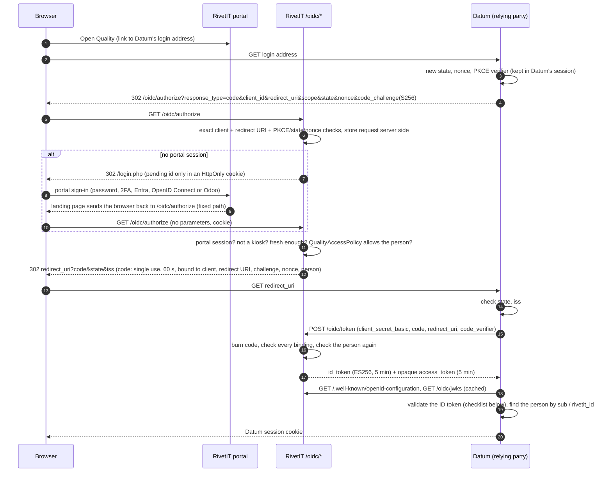

# QMS integration: single sign-on (RivetIT as an OpenID Connect provider)

Status: implemented in RivetIT (issue #55, part of #52). The Datum side is a separate change in the Datum repository. Targets: OWASP ASVS Level 2, OpenID Connect Core 1.0 (security considerations), RFC 6749, RFC 7636 (PKCE), RFC 9207.

A person who is signed in to the department portal presses **Open Quality** and lands in Datum already signed in. RivetIT is the identity hub (decision in `qms-overview.md`); Datum is a relying party. RivetIT is **also** an OIDC *client* of outside providers for the portal login (`docs/OPENID_CONNECT_PORTAL.md`) and has a separate built-in OAuth server for Remote MCP (`docs/REMOTE_MCP.md`); neither is reused or changed here. This provider has its own endpoints, keys and tables.

Passwords, sessions and cookies are never shared between RivetIT and Datum. Datum gets a signed statement of who the person is, once, and keeps its own short session.

## Flow

## Endpoints

All under the issuer, which is `https://` plus the host of the configured base URL (`$config_base_url`). The issuer is never built from `Host`, `Forwarded` or `X-Forwarded-*` headers.

| Path | Method | Purpose |
|---|---|---|
| `/.well-known/openid-configuration` | GET | Discovery document. 404 while the provider is off. Cacheable 5 minutes. |
| `/oidc/jwks` | GET | Public signing keys (JWKS). 404 while off. Cacheable 5 minutes. |
| `/oidc/authorize` | GET | Authorization endpoint. `POST` exists only for the "sign in again" button. |
| `/oidc/token` | POST | Code exchange. `application/x-www-form-urlencoded`. `client_secret_basic` or `client_secret_post`. |
| `/oidc/userinfo` | GET, POST | Claims for the access token (`Authorization: Bearer`, header only). |

End-session (RP-initiated logout) is **not** provided: Datum keeps its own short session and logs out locally; there is no shared cookie to clear.

nginx maps these to one PHP front controller (`oidc/index.php`) through the managed routes file (`deploy/templates/rivetit-locations.conf`, registry ids `oidc_discovery` and `oidc_endpoints`). See `docs/WEB_ROUTES.md`.

### Authorization request

| Parameter | Rule |
|---|---|
| `response_type` | exactly `code`. Anything else (`token`, `id_token`, hybrid) is `unsupported_response_type`. |
| `client_id` | the integration client id (`ic_...`) of a client holding the `sso` capability **and** a registration. |
| `redirect_uri` | **exact string match** against the registered list. No normalisation, wildcard, prefix or port range. A mismatch (or unknown client) shows a plain page and never redirects. |
| `scope` | `openid` required; `profile` optional and only if the registration allows it. Any other scope (`email`, `phone`, `offline_access`) is `invalid_scope`. |
| `state` | required, 8 to 512 printable ASCII characters. Returned unchanged. |
| `nonce` | required, 8 to 255 printable ASCII characters. Placed in the ID token. |
| `code_challenge`, `code_challenge_method` | required; method must be `S256`; `plain` and a missing method are `invalid_request`. |
| `prompt` | `login` forces a fresh portal sign-in; `none` never shows a page and answers `login_required` if interaction would be needed. |
| `max_age` | honoured (the smaller of it and the configured maximum applies; `0` forces a fresh sign-in). |
| `request`, `request_uri`, `response_mode` other than `query` | refused. |
| duplicated parameters | refused with the plain page. |

The response is a 302 to the registered `redirect_uri` with `code`, `state` and `iss` (RFC 9207), or `error`, `state` (when valid) and `iss`. Errors that arise after the client and redirect URI are verified go back to the client; everything earlier, and every refusal about the *person*, is a plain RivetIT page that reflects nothing from the request.

### Token request

`grant_type=authorization_code` only; `password`, `client_credentials`, `refresh_token` and anything else are `unsupported_grant_type`. There are no public clients and no refresh tokens. Fields: `code`, `redirect_uri` (must equal the one in the authorization request), `code_verifier` (43 to 128 characters of `A-Za-z0-9-._~`). Response: `access_token` (opaque, `rvo_...`), `token_type=Bearer`, `expires_in`, `id_token`, `scope`. Every response carries `Cache-Control: no-store` and `Pragma: no-cache`.

Errors follow RFC 6749 section 5.2 with fixed descriptions: `invalid_client` (401, uniform for unknown client, wrong secret, revoked/expired client or secret, IP not allowed, and a valid integration credential without the `sso` capability), `invalid_grant` (code unknown, expired, used, wrong client, wrong redirect URI, wrong verifier, person no longer allowed), `invalid_request`, `unsupported_grant_type`, `temporarily_unavailable` (429 / provider off).

A code is **burned on its first presentation**, whatever the outcome: a wrong verifier or redirect URI does not leave the code available for a second guess. Presenting a code that was already used revokes every access token issued from it and is audited as `code_replay`.

## ID token

ES256 (ECDSA P-256 with SHA-256). Header: `alg=ES256`, `typ=JWT`, `kid`. Lifetime 5 minutes by default (60 to 600 seconds, set on the admin page).

| Claim | Value |
|---|---|
| `iss` | the issuer |
| `aud` | the client id (`ic_...`), a single string |
| `sub` | **the Odoo employee id** (decimal string, e.g. `"1842"`) when the person is linked to Odoo, otherwise `"rivetit:<contact id>"` (e.g. `"rivetit:6"`) |
| `rivetit_id` | the RivetIT contact id, as a string. Always present |
| `iat`, `nbf`, `exp` | issue time, not-before (same as `iat`), expiry |
| `auth_time` | when the person signed in to the portal (Unix seconds), not when the token was minted |
| `nonce` | the nonce from the authorization request |
| `amr` | how the portal sign-in happened: `["pwd"]`, `["pwd","otp","mfa"]` (password plus authenticator or recovery code) or `["fed"]` (Entra, OpenID Connect or Odoo). Empty for a portal session that predates this feature (which is also treated as stale) |
| `jti` | unique id of this token |
| `at_hash` | left half of SHA-256 of the access token, base64url (OIDC Core 3.1.3.6; optional for Datum to check) |
| `name` | the contact's display name, **only** when `profile` was requested and the registration allows it |

Never present: email, phone, PIN, address, department, job title. Datum must not match people by name or email.

`sub` and linking. The Odoo employee id is the shared person key across Odoo, RivetIT and the QMS (`qms-overview.md`). A person who is **not yet linked** to Odoo (a contractor, or a new hire before the next directory sync) gets `rivetit:<id>`; when they are linked later, their `sub` changes to the Odoo id. Datum should therefore store both `sub` and `rivetit_id` per person, match on the Odoo id when `sub` is numeric, fall back to `rivetit_id`, and send anyone it cannot match to its review queue instead of creating an account from a name or email. A `sub` that starts with `rivetit:` means "not linked to Odoo".

### Userinfo

`{"sub": "...", "rivetit_id": "..."}` plus `name` under the same rule as the ID token. The access token is opaque (`rvo_` plus 43 URL-safe characters), stored by RivetIT only as a SHA-256 hash, valid 5 minutes by default (60 to 600 seconds), accepted only in the `Authorization` header, and re-checked against the person's current eligibility on every call. An SSO token is not accepted anywhere under `/api/v1`, and an LMS API token or API key is not accepted at `/oidc/userinfo`.

## Who may sign in: `QualityAccessPolicy`

`ITFlow\Oidc\QualityAccessPolicy::allows($contactId)` returns `{ok, reason}` and is called at three points: authorize, token exchange and userinfo. Disabling the person, their department, the portal or the provider therefore takes effect at the next call, not when a token expires.

Current rule: the provider is switched on **and** the contact is an eligible department-portal person: the contact exists, is not archived and has employment status `active`; it is linked to a portal login (`users.user_type = 2`) that is enabled and not archived; its department is not archived and is `Active`; the department portal is switched on; and the person is not stuck at the portal's own "set up two-factor first" gate.

In addition `/oidc/authorize` refuses (plain page, audited): an agent session or an admin portal preview (not a department person), a kiosk or shared-screen session (`$_SESSION['kiosk_session']`, `kiosk_device` or `is_kiosk` set; the kiosk subsystem never starts a PHP session and its cookies are scoped to `/kiosk/`, so this is a guard for any future code that ties a PHP session to a shared screen), and a session whose user does not own the contact.

**Phase 1 hook (not built yet).** The Quality module switch (`settings.config_module_enable_quality`), the per-department list (`quality_departments`) and any portal-role restriction do not exist yet, and this change does not invent them. When Phase 1 adds them, add the checks at the marked block in `QualityAccessPolicy::allows()` and return reasons such as `module_disabled`, `department_not_enabled` or `role_not_allowed`. Nothing else changes: authorize, token and userinfo already call this one function and audit whatever reason it returns. The "Open Quality" button should then also use it (today it appears whenever the provider is on and a client has a login address).

### Sign-in age and re-authentication

The portal session itself can live for days. The provider therefore requires that the portal **sign-in** (`$_SESSION['portal_auth_time']`, set by `login.php` and the Entra, OpenID Connect and Odoo callbacks) is no older than the configured maximum (default 8 hours, 5 minutes to 24 hours). An older sign-in, a session with no recorded sign-in time, `prompt=login`, or a smaller `max_age` shows a "Sign in again" page. Its button (CSRF-protected) ends the portal session and sends the browser to the portal sign-in; after the new sign-in the browser comes back and finishes the request.

### Resuming after the portal sign-in

The validated request is stored in `oidc_pending`, keyed by the SHA-256 of a 256-bit random id. The id lives only in an HttpOnly, SameSite=Lax cookie (`rivet_oidc_pending`, 10 minutes), never in a URL. After a portal sign-in, `client/includes/check_login.php` sends the browser to the **fixed** path `/oidc/authorize` if (and only if) the cookie names a still-valid pending request; no request value is ever placed in a redirect target. The pending request is consumed exactly once, so back/forward or a second tab cannot replay it, and its client and redirect URI are re-checked against the registration when it resumes.

## Administration

Administration > **Single sign-on provider** (`admin/sso_provider.php`): the kill switch, maximum portal sign-in age, ID token and access token lifetimes (bounded), the issuer and discovery URL (with a copy button), the Datum registration (redirect URIs, login-initiation URL, whether the display name is shared), the active signing key id with a **Rotate** button, and the 50 most recent sign-in events. Every change needs a CSRF token and an administrator, and is audited.

Registering Datum: create an integration client (Administration > Integration clients) with the **`sso`** capability (add `lms:*` scopes only if Datum also calls the training API); copy the client id and secret once; then on the SSO page enter its redirect URIs and the login address. The login address is validated at save time (https only, no userinfo or fragment, and the existing `UrlPolicy`: public addresses plus networks listed under Internal network access; loopback, link-local and metadata addresses never). The portal's **Open Quality** button opens it; it is hidden while the provider is off, when no client has a login address, in the admin preview and on a kiosk.

The `sso` capability is a property of the client, not an API scope: `POST /api/v1/oauth/token` never puts it in a token, and a client that holds only `sso` cannot obtain an API token at all.

## Signing key and rotation

ES256 key pair, generated on first use, one `kid` (16 hex characters). The private key is stored only as `encryptSetting()` output under its own context (`oidc_signing_key`) in `oidc_signing_keys`, and is registered in `ITFlow\Crypto\ColumnRegistry` so a settings-key rotation re-wraps it. It is never displayed, logged or exported.

**Rotate** (admin page) creates a new key, which signs every new token at once, and marks the previous key *retired*. A retired key stays in the JWKS for 15 minutes (the longest allowed ID token lifetime, 10 minutes, plus a 5 minute clock-skew allowance), so tokens it signed stay verifiable, and then drops out. Retired rows are deleted after another 30 days. Datum must refetch the JWKS when it sees an unknown `kid` (with a small rate limit), and may cache it for up to the `Cache-Control` lifetime.

## Rate limits, audit, headers

- `authorize`, `token` and `userinfo` are limited per address network (IPv6 per /64) on the shared Redis (fails open if Redis is down, like the other abuse guards) **and** by counters read from `oidc_events`, which keep working without Redis. Failed client authentication on the token endpoint is capped per address (20 in 10 minutes) and per address and client (8), as for the LMS token endpoint. Limited requests get `429` with `Retry-After`.
- Every code issued, token issued, refusal (with a reason code), replay, admin change and key rotation is one row in `oidc_events` (shown on the admin page) and one line in the audit log. Rows hold reason codes and ids only: never a code, token, secret, state, nonce, or request-supplied URL.
- Authorize pages: `Cache-Control: no-store`, `Pragma: no-cache`, `Referrer-Policy: no-referrer`, `X-Frame-Options: DENY`, CSP `default-src 'none'; frame-ancestors 'none'; base-uri 'none'; form-action 'self'`, no scripts. Token and userinfo responses: `no-store` and `Pragma: no-cache`. Codes, tokens and secrets are compared as SHA-256 digests looked up by key, or with `hash_equals()`.

## Threat notes

| Threat | Control |
|---|---|
| Open redirect via `redirect_uri` | exact match against a registered list; no wildcards; mismatch is a page, not a redirect |
| Open redirect on the post-login resume | fixed target path; the cookie is only a lookup key into a server-side record |
| Code interception or injection | PKCE S256 (required), `state` echo plus `iss` (RFC 9207), code bound to client, redirect URI, challenge, nonce and person, 60 seconds, burned on first use |
| Code replay | single use; replay revokes the tokens issued from it and is audited |
| Mix-up / wrong issuer | `iss` in the response and in the ID token; the issuer comes from configuration only |
| Token substitution / confused deputy | `aud` is the client id; SSO tokens are rejected on the API and API tokens at userinfo; the `sso` capability never appears in an API token |
| Credential guessing at the token endpoint | secrets are 256-bit values stored with `password_verify`; uniform `invalid_client`; same timing for unknown clients; DB-backed lockout independent of Redis |
| Stale or shared-screen sessions | maximum sign-in age with forced re-authentication; kiosk and agent sessions refused |
| Deprovisioned person keeps access | eligibility re-checked at authorize, token and every userinfo call; tokens last 5 minutes; kill switch |
| Key compromise or rotation | private key encrypted at rest and registered for settings-key rotation; admin rotate with overlap |
| Clickjacking, caching, referrer leaks | headers above |
| Information disclosure through errors | fixed messages; reasons only in the audit log |

## What Datum must implement (validation checklist)

1. Read `/.well-known/openid-configuration` from the configured issuer (HTTPS, validate the certificate). Take every endpoint and the `jwks_uri` from it. Check that `issuer` equals the configured value exactly.
2. Per sign-in: generate `state` (>= 128 bits), `nonce` (>= 128 bits) and a PKCE `code_verifier` (43 to 128 characters); keep them in Datum's own server-side session; send `code_challenge=BASE64URL(SHA256(verifier))` with `code_challenge_method=S256`, `response_type=code`, `scope=openid` (add `profile` only if wanted), and the registered `redirect_uri` byte for byte.
3. On return: reject unless `state` matches the session's value (constant time) and the `iss` parameter, when present, equals the issuer. Reject an `error` response without trying anything else. Use the code once.
4. Exchange the code with `client_secret_basic` (or `client_secret_post`) over HTTPS, no redirects followed, with the same `redirect_uri` and the `code_verifier`. Treat anything but a 200 as a failed sign-in. Never log the code, tokens or the secret.
5. Validate the ID token before trusting anything in it:
   - exactly three JWT segments; the header `alg` is `ES256` (reject `none`, any HMAC algorithm, and anything not in `id_token_signing_alg_values_supported`); the key is chosen by `kid` from the JWKS (refetch once on an unknown `kid`, rate limited) and **never** taken from the token;
   - signature valid;
   - `iss` equals the issuer exactly; `aud` is (or contains only) Datum's own client id; if `aud` has several values, `azp` must equal the client id;
   - `exp` is in the future and `iat`/`nbf` are not in the future, each with at most 60 seconds of clock skew; reject a token older than the 5 minute lifetime;
   - `nonce` equals the nonce stored for this sign-in (and is then forgotten);
   - `sub` and `rivetit_id` are non-empty strings; if `max_auth_age` matters to Datum, `auth_time` is recent enough;
   - optionally `at_hash` matches the access token.
6. Identify the person only by `sub` (Odoo employee id) and `rivetit_id`. Never by `name` or by an email. Someone Datum cannot match goes to the review queue; Datum does not create an account from the token alone.
7. Start Datum's own short session (secure, HttpOnly, SameSite=Lax cookie, new session id at sign-in). Do not share cookies or passwords with RivetIT. Log out locally; there is no RivetIT logout endpoint.
8. Treat the ID token as a one-time proof of sign-in: do not store it, do not use it as a session or API credential. If Datum wants to refresh the person's status, call `/oidc/userinfo` with the access token within its 5 minute life; a 401 means the person is no longer allowed.
9. Keep the client secret in a secret store, rotate it with the overlap feature on the Integration clients page, and alert on repeated `invalid_client`.

## Server step (administrator)

1. Take a database backup. Run **Administration > Update > Update Database** (DB 2.6.202 creates the `oidc_*` tables; nothing is switched on).
2. Add the nginx routes through the managed web-routes apply (`sudo deploy/apply-web-routes.sh --domain <domain>`, see `docs/WEB_ROUTES.md`). Administration > Server status reports the two routes as missing until this is done.
3. Create the integration client with the `sso` capability, register Datum's redirect URI(s) and login address, and switch single sign-on on.
4. Give Datum the client id, the secret (shown once) and the issuer; it reads everything else from the discovery document.
